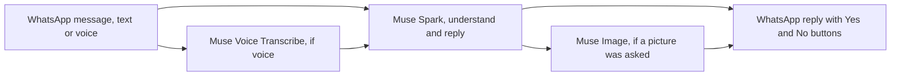
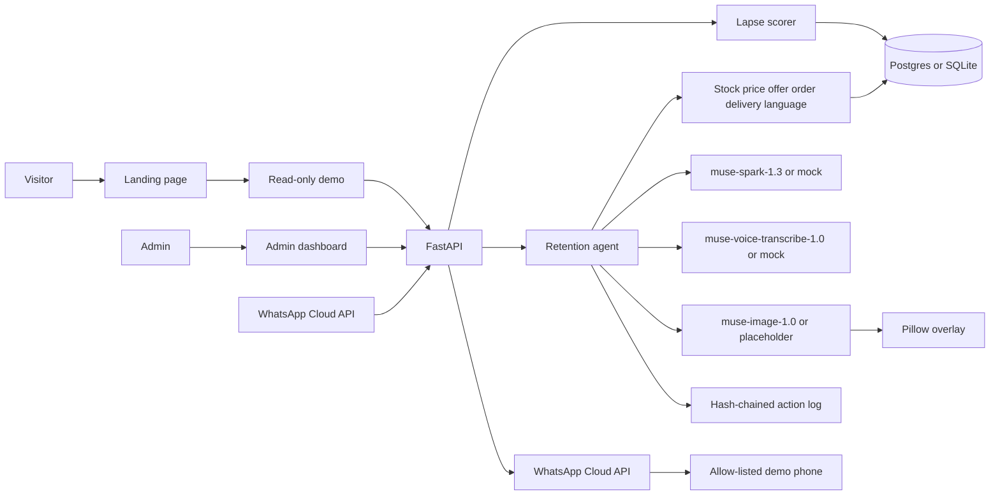

# Convoplex Retention Agent

Convoplex Retention Agent is a WhatsApp win-back agent for Nigerian retailers, built in Lagos. A shopkeeper sees who has gone quiet, sends one offer with a real naira price, and the customer can answer by text or voice note in the language they choose.

Built for the Meta Global AI Developer Hackathon (Cerebral Valley), theme Build for Your World, Indie track. The event window is 27 Oct to 4 Nov 2026. All application code in this repository was written during the event. The dataset is synthetic.

Live demo: [https://convoplex-retention-agent.vercel.app/](https://convoplex-retention-agent.vercel.app/)

Read-only shop view: [https://convoplex-retention-agent.vercel.app/demo](https://convoplex-retention-agent.vercel.app/demo)

Source: [https://github.com/vumoz/convoplex-retention-agent](https://github.com/vumoz/convoplex-retention-agent)

## Powered by Meta models

Live text is Muse Spark (`muse-spark-1.3`), pictures are Muse Image (`muse-image-1.0`), and voice notes are Muse Voice Transcribe (`muse-voice-transcribe-1.0`). All three go through the Meta Model API (Application Programming Interface) at `https://api.meta.ai/v1`. The defaults live in `convoplex/config.py`. `META_API_KEY` is read from the environment and is never written to the database, the action log, or this repository. With the key unset, `MockMuse` in `convoplex/llm.py` returns the same tool-call shape so tests and a laptop demo stay offline. Some turns are answered by trusted code after the model has already done its part, or instead of a second model call: a picture can reuse a stored card, a greeting can quote the open offer, and a language-only switch does not wait on another completion. Those shortcuts are named below. They do not replace the models. They keep the models from inventing a price or a yes.



### Text: Muse Spark

`muse-spark-1.3` is the chat model. `LiveMuse` in `convoplex/llm.py` posts to `/v1/chat/completions`. WhatsApp replies send `reasoning_effort` `minimal`, the shortest effort Muse Spark accepts (`none` is rejected). A message that only changes language stops after `set_language` and does not make a second completion (`convoplex/agent.py`).

What the model writes, in the customer's language (formal English, Broken English (Nigerian Pidgin), Igbo, Yoruba, or Hausa):

- The first win-back (`draft_winback` in `convoplex/agent.py`). The model calls `check_stock`, `get_price`, and `create_offer`. The discount has to sit between 5 and 15 percent. The offer price is computed in `convoplex/tools.py` from the database price. The model cannot pass a price in.
- Every later reply. The same tool list adds `place_order`, `get_delivery_options`, `set_language`, `ask_phrase`, `learn_phrase`, and `send_offer_card`.
- Purchase understanding. The model proposes accept, decline, or a question. Trusted code in `convoplex/agent.py` and `convoplex/purchase.py` keeps the states `offer_presented`, `clarification_required`, `confirmed`, `declined`, and `expired`. `place_order` writes nothing unless a confirmation matches that customer, product, quantity, and offer. A repeated "won't buy" is never consent. A clear Yes, including the WhatsApp button `buy_yes`, is what confirms.
- A brand the shop does not stock (`convoplex/substitute.py`). Muse Spark is told the name is missing. The reply then names an in-stock alternative and the database price, and the Yes/No buttons stay on the offer. Spaghetti is not rewritten into rice.
- Market greetings (`convoplex/greeting.py`). "My customer" and "Customer", including voice spellings such as costoma and kustoma, are an address, not a product. The shop mirrors the form the customer used, answers "how you dey" only when they greeted, and then continues the sale. The rest of the sentence still opens or reuses an offer. A reply that is only the address is replaced.
- The lexicon (`convoplex/lexicon.py`). Seed words from `docs/broken-english-notes.md` go into the prompt as data (`glossary: phrase = meaning`), not as instructions. `ask_phrase` fires only when one unknown word blocks the sale, at most once per turn and twice per conversation. When the customer explains the word, `learn_phrase` stores it in the same turn and the sale continues. The customer never hears that a word was saved. Address terms such as "customer" are refused as lexicon entries.

The guards around the model are the point. Muse Spark proposes the words and the tool calls. Stock, naira amounts, consent, and which customer the call may touch are checked in `convoplex/tools.py`, `convoplex/commercial.py`, `convoplex/purchase.py`, and `convoplex/execution.py` before anything is sent or written.

### Image: Muse Image

`muse-image-1.0` draws a text-free product photograph. `convoplex/integrations/images.py` posts to `/v1/images/generations`. The prompt (`promo_prompt`) names the shop and the product and tells the model not to paint letters, digits, or prices.

Pillow then prints the shop, the product, the offer price, the list price, and the discount in `render_promo_card` / `overlay_copy`, using DejaVu Sans bundled in the repo so ₦ and tone-marked Igbo, Yoruba, and Hausa letters render on Vercel. The figures come from the offer row, not from the picture model.

When a customer asks to see the product (`wants_product_image` in `convoplex/messages.py`, or the `send_offer_card` tool), that request is decided before a greeting or a text-only product pitch (`convoplex/agent.py`). `ensure_promo_bytes` in `convoplex/whatsapp_flow.py` sends the cached card for that offer if one is already stored, otherwise the Mama Gold card shipped at `convoplex/assets/mama-gold-rice.webp` with the current database price painted on locally, and only then tries a live Muse Image draw. The caption repeats the product, the database price, and the hold question. Yes and No buttons still go out. If the upload fails, it is retried once, a `whatsapp_image` line is written to the action log, and the text says the picture is coming.

### Voice: Muse Voice Transcribe

`muse-voice-transcribe-1.0` is the ASR (Automatic Speech Recognition) model. `convoplex/integrations/voice.py` posts multipart audio to `/v1/asr/transcribe`. WhatsApp sends OGG. The file is converted to mono 16-bit WAV at 16 kHz or 24 kHz before the call. `_audio_reply` in `convoplex/whatsapp_flow.py` then runs the transcript through the same reply path as typed text.

What that unlocks:

- A voice note in Broken English (Nigerian Pidgin), Igbo, Yoruba, or Hausa is answered in that language.
- An explicit language request wins, including mishearings. `explicit_language` in `convoplex/languages.py` maps "house a" and "ausa" to Hausa, "yaruba" to Yoruba, and "ibo" to Igbo, and saves the new language before the reply is written. If Muse Spark skips `set_language`, the reply is still forced into the language that was asked for.
- "I wan buy" on a Broken English voice note is often transcribed as "I won't buy". That pair does not cancel the offer and does not count as a yes. The customer gets one clarify line with the product and the database price, and the Yes button. Only a clear yes after that places the order (`convoplex/llm.py`, `convoplex/agent.py`).

### Where each model shows up

| Model | Modality | Where in the code | What the customer sees |
| --- | --- | --- | --- |
| `muse-spark-1.3` | Text | `convoplex/llm.py`, `convoplex/agent.py`, `convoplex/prompts.py` | The win-back, the reply, the clarify line, the greeting, and the yes/no question, in their language |
| `muse-image-1.0` | Image | `convoplex/integrations/images.py`, `convoplex/whatsapp_flow.py` | The promo card when they ask for a picture, with the database price printed on it |
| `muse-voice-transcribe-1.0` | Voice | `convoplex/integrations/voice.py`, `convoplex/whatsapp_flow.py` | A voice note treated as a normal message: language switch, offer, or picture |

## How this was built

Victor Obioma Umozurike designed the product, made every product and language decision, and tested it in real WhatsApp conversations. An AI coding assistant wrote the code under his direction. The work in this repository was built during the hackathon, from 26 Oct 2026 onward. At runtime, Meta's models power every customer reply, every promo-card picture, and every voice note.

## Why Nigeria

Retail in Lagos, Abuja, and Port Harcourt runs on WhatsApp. A provision shop, a fabric stall, or a phone seller does not have a retention team. When a regular stops buying, the next message is another job on top of the counter. The offer has to name a product that is actually on the shelf, a price in naira, and wording the customer already uses. English is the default. Many customers would rather continue in Broken English (Nigerian Pidgin), Igbo, Yoruba, or Hausa, including by voice note.

## What it does

- Scores lapsed and at-risk customers and writes down why.
- Drafts a win-back with a 5–15% discount taken from the database price. The model cannot invent the price.
- Places the order on acceptance, with pickup or same-city delivery, and decrements stock.
- Draws a promo card: the image model paints the product, and the naira figures are printed afterwards so they match the offer.
- Transcribes a voice note and runs it through the same reply path as typed text.
- Answers in formal English until the customer opts into another language, by typing or by voice.

The public page at `/` explains the project. `/demo` is a read-only view of the synthetic book: customers, offers, the language mix, recent messages, the hash-chained action log, and a promo card. Phone numbers are masked to the last two digits. `/admin` is the same dashboard with the controls that change the book. Those writes require `ADMIN_TOKEN` when it is set.

## Architecture



Local runs and tests use SQLite and a JSONL action log. On Vercel, `DATABASE_URL` points at Neon Postgres: the shop, the action log, promo-card bytes, the WhatsApp session, and the rate-limit counters. The webhook returns 200, then FastAPI `BackgroundTasks` finish the reply inside the same invocation.

Scoring, in short: cadence is the median gap between orders, capped at 45 days. Repeat customers still inside 35 days and 1.25× cadence are active. Quiet up to 60 days and within 2× cadence are at risk. Beyond that, up to 120 days, they are lapsed. Longer than 120 days is lost.

## Meta models

The models, the endpoints, and the guards around them are in [Powered by Meta models](#powered-by-meta-models) above. `META_API_KEY` stays an environment variable. Tests run in mock mode and do not call Meta.

## Languages

English is the default. The other options are opt-in: Broken English (Nigerian Pidgin), Igbo, Yoruba, and Hausa. Customer-facing copy calls the pidgin option Broken English. This README uses Broken English (Nigerian Pidgin) so an international reader can see both the label and the language.

A customer switches by typing or saying the language name, including short voice mistakes such as “Yurba” for Yoruba, or a sentence such as “Make you talk to me for Hausa.” The confirmation is in the new language. Inside the 24-hour WhatsApp window it is free text. Outside that window the only outbound template is `hello_world`.

Prices stay in ₦. Product names stay as stored. The model is told not to mix languages unless the customer already did.

Igbo, Yoruba, and Hausa wording is pending native-speaker review. The replies are a first draft for the hackathon, not a finished translation.

## Synthetic data

Every retailer, customer, order, product, and offer is fictional, and the schema rejects a row that is not marked synthetic. Prices are illustrative whole naira amounts, not live market quotes. Phone numbers are generated and the public API masks them to the last two digits. Do not message them. There is no client list and no production shop data in this repository.

The book is 500 customers across six shops, with orders from 27 Apr 2026 to 26 Oct 2026. Scores use a scenario date of 27 Oct 2026 so the demo does not drift after the event. Shops include Mama Nkechi Provisions (Ikeja), Alhaja Bisi Textiles (Lagos Island), and Wuse Fresh Basket (Wuse 2).

## Self-learning language trainer

The agent keeps a lexicon of words it has learned. Seed rows come from `docs/broken-english-notes.md` (Broken English (Nigerian Pidgin)): wan, abeg, wahala, sabi, chop, how much e be, and kpai. On each reply the active words for that customer's language are added to the prompt as a data block, `glossary: phrase = meaning`, not as instructions.

When the model does not understand a word, in English, Broken English (Nigerian Pidgin), Igbo, Yoruba, or Hausa, it asks one short question in the customer's language. The same phrase is not asked again in that conversation, and the offer stays as it is. When the customer explains a word, or confirms one the model inferred, `learn_phrase` stores it immediately. Repeat explanations increment the confirmation count. Victor can remove a word from the admin dashboard. Remove is a soft delete and can be restored. The public demo lists the words and cannot remove them.

`GET /v1/lexicon` is a public read with no phone numbers or customer names. `POST /v1/lexicon/{id}/remove` and `POST /v1/lexicon/{id}/restore` require the admin token.

## How to run locally

Python 3.11 or newer. The supported runtimes are Linux, macOS, and Vercel. Windows native is unsupported for now: the action log and WhatsApp state use `fcntl`, which Windows does not provide. Use Linux, macOS, or the Vercel deployment instead of a native Windows checkout.

`CONVOPLEX_PROFILE` is `local` (the laptop and the test suite, open when `ADMIN_TOKEN` is unset), `public`, or `pilot`. A public or pilot profile with no `ADMIN_TOKEN` refuses shop writes and `/health` reports not ready. Live WhatsApp (`CONVOPLEX_CHANNEL=whatsapp`) also needs `WHATSAPP_APP_SECRET` or readiness fails. The channel switch is stored in the database so every instance, including a cold start, sees the same mode. `CONVOPLEX_OUTBOUND=off` stops new WhatsApp sends and leaves drafts in place.

The provider webhook does not change the book while the channel is `simulator`. Exercise that path with `POST /v1/whatsapp/simulate` and the admin token. `/demo` stays read-only. Unmapped senders are ignored. There is no fallback customer.

If a deploy goes wrong: set `CONVOPLEX_OUTBOUND=off`, switch the channel back to `simulator` (or set `CONVOPLEX_CHANNEL=simulator` and clear the `channel_mode` row), rotate `ADMIN_TOKEN` and `WHATSAPP_APP_SECRET`, and restore the database from the Neon backup. Do not put secrets in git.

```bash
python -m venv .venv
source .venv/bin/activate
pip install -r requirements.txt
pip install -e .
pytest
python -m convoplex serve
```

Open `http://127.0.0.1:8000/` for the landing page, `/demo` for the read-only view, and `/admin` for the dashboard. Leave `ADMIN_TOKEN` unset on your laptop: the local API stays open, which is what the tests expect.

```bash
python -m convoplex demo --mock --customer 184 --lang pcm
```

That drafts an offer for a lapsed customer who prefers Broken English (Nigerian Pidgin) and accepts it. `--live` uses the Meta models when `META_API_KEY` is set. `--mock` forces the offline model.

## What was built during the hackathon

The core agent, voice notes, promo cards, and the first dashboard landed in pull requests #1 and #2. The work after that:

- **#3** WhatsApp Cloud API channel for one allow-listed demo phone. Outside the 24-hour window the send is the `hello_world` template. Full message ids are not stored, because they embed the phone number.
- **#4** Deploy to Vercel with Neon Postgres, the action log and promo cards in the database, and a webhook that returns 200 before the model runs.
- **#5** The Postgres usage-counter upsert that was blocking the first live reply, and a webhook that keeps going if that counter throws.
- **#6** Per-customer language opt-in, and DejaVu fonts bundled so promo cards render ₦ and tone-marked letters on Vercel.
- **#7** The same language switch on voice-note transcripts, and a confirmation that stays free text while the WhatsApp window is open.
- **#8** Fuzzy matches for misheard names, a `set_language` tool so the model cannot acknowledge a language and then keep the old one, and a log line that records the text that was actually sent.
- **#9** A language-only switch sends the fixed confirmation without a second model call. WhatsApp replies use `reasoning_effort` `minimal` and do not double the token budget after a length cutoff. Inbound messages are marked read with the typing indicator, and the action log stores inbound-to-send latency.
- **This change** adds the public landing page, the read-only `/demo` view, and this judge-facing README plus `docs/submission-writeup.md`. Shop writes require the admin token whenever it is set.

## Deploy to Vercel

The public app is one Vercel Python function (`app.py`, Fluid Compute, `maxDuration` 300). Hobby functions stop at 300 seconds. Pro can go to 800, and an extended beta can go to 1800 on Python 3.12 and newer. This repo stays at 300 so Hobby can deploy it.

Set secrets in the Vercel project, not in git: `META_API_KEY`, `WHATSAPP_TOKEN`, `WHATSAPP_APP_SECRET`, `WHATSAPP_VERIFY_TOKEN`, `WHATSAPP_DEMO_TO`, `ADMIN_TOKEN`. Plain settings: `WHATSAPP_PHONE_NUMBER_ID` (`1150414038145295`), `CONVOPLEX_CHANNEL`, `GRAPH_API_VERSION`, and `DATABASE_URL` from Neon. Optional caps: `META_DAILY_CAP` (80), `TRY_IP_LIMIT` (60), `TRY_WINDOW_SECONDS` (3600).

When `ADMIN_TOKEN` is set, reset, language changes, win-back, reply, voice, promo cards, the channel switch, and WhatsApp sends all require it (`Authorization: Bearer`, `X-Admin-Token`, or the dashboard unlock cookie). The landing page, `/demo`, and the read APIs stay open. The webhook does not use the admin token. On the live channel it requires a valid `X-Hub-Signature-256`.

Webhook, subscribed to the `messages` field:

```text
https://<project>.vercel.app/v1/whatsapp/webhook
```

The production host is `https://convoplex-retention-agent.vercel.app`.
