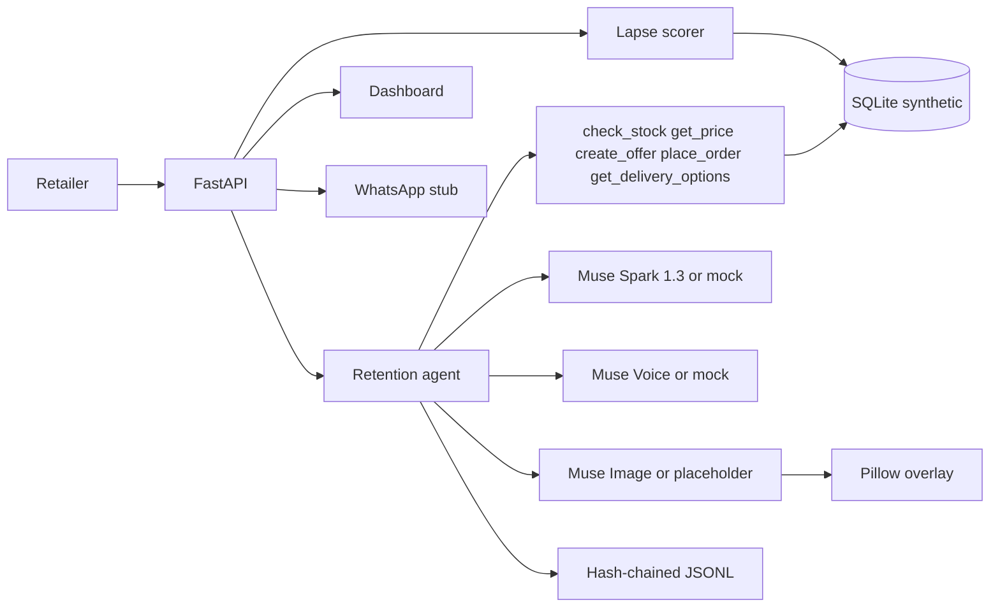

# Convoplex Retention Agent

An AI agent that finds a Nigerian retailer's lapsed customers and wins them back with WhatsApp-style messages.

Built in Lagos for Nigerian retailers, during the Meta AI Developer Hackathon, Oct 27 to Nov 4 2026. Indie track, solo builder. Theme: Build for Your World.

All application code in this repository was written during the event. The dataset is synthetic.

## What it does

A shop in Lagos, Abuja, or Port Harcourt quietly loses regulars. Convoplex scores who has gone quiet, explains why, and drafts a personal message in English or Nigerian Pidgin with a real naira price from the shelf. If the customer accepts, the agent places the order and decrements stock.

This build is the core, end to end, on synthetic data:

- 500 fictional customers across six shops, with orders from 27 Apr 2026 to 26 Oct 2026. Scores use a scenario date of 27 Oct 2026 so the demo does not drift after the event.
- RFM-style lapse scoring with a written reason for every customer.
- A Muse Spark tool loop: `check_stock`, `get_price`, `create_offer`, `place_order`, and `get_delivery_options` (synthetic pickup and a 1–2 day same-city window). The model is told not to invent a delivery weekday.
- The payday state stays in context. The first win-back writes one natural sentence in the customer's language (on 27 Oct, Pidgin "Month-end dey this week, e good time to stock up."). The raw state is not pasted into the message. A decline does not mention payday. Festive notes are included when they apply.
- An append-only hash-chained action log, with a verify command.
- A FastAPI backend for the at-risk list, win-back, replies, metrics, and the log.
- Voice-note replies. OGG/Opus is converted to mono 16-bit WAV, transcribed, and fed through the same decline / price question / accept path as a typed reply. The action log stores the transcript, latency, and model.
- Promo cards. `muse-image-1.0` draws a text-free product photo. Pillow then prints the shop, the product, the naira prices, and the percent off, so the numbers match the offer.
- A single-page dashboard for the three-minute demo: customers by shop, the thread, a reply box, a voice-note upload, the promo card, metrics, and the action log with a verify button.

The WhatsApp Cloud API is still a stub. The webhook can verify and parse. Nothing is sent.

## Meta models

| Model | Role in this build |
| --- | --- |
| `muse-spark-1.3` | Drafts the win-back and handles the reply. OpenAI-compatible `POST /v1/chat/completions` on `https://api.meta.ai/v1`. Tools are the shop functions above. `max_tokens` floors at 2500 while tools are attached, because reasoning tokens count against the limit. A `finish_reason` of `length` is retried once at double that budget. |
| `muse-voice-transcribe-1.0` | Transcribes a voice-note reply. `POST /v1/asr/transcribe` is multipart: a JSON `request` part (`model`, `audioEncoding` `WAV`, `mode` `PUSH_TO_TALK`) plus the audio file. Audio must be mono 16-bit WAV at 16 or 24 kHz. OGG/Opus notes are converted with `ffmpeg -i in.ogg -ac 1 -ar 16000 -sample_fmt s16 out.wav`. |
| `muse-image-1.0` | Draws the product photo for a promo card. `POST /v1/images/generations` with `model`, `prompt`, and `n`, response `data[0].b64_json` (WEBP). The prompt names the shop, city, product, and naira prices, and tells the model not to paint text. Pillow overlays the exact figures. |

The API key is the `META_API_KEY` environment variable. It is never written to the database, the action log, or this repo. When the variable is unset, the agent uses a deterministic mock that issues the same tool-call shape. Tests and CI run in mock mode.

## Architecture



Scoring rules, in short: cadence is the median gap between orders, capped at 45 days. Repeat customers still inside 35 days and 1.25× cadence are active. Quiet up to 60 days and within 2× cadence are at risk. Beyond that, up to 120 days, they are lapsed. Longer than 120 days is lost. The priority score weights lapse more heavily than raw spend, and every score comes with the numbers that produced it.

Offers are 5 to 15 percent off the database price. The model cannot name its own price. `place_order` caps quantity at the shelf and at 10 units per order. Accepting an offer places a `whatsapp_sim` order. That label means the conversation was simulated. This build does not send a WhatsApp message.

## Synthetic data

Every retailer, customer, order, product, and offer row is fictional and the schema rejects a row that is not marked synthetic. Prices are illustrative whole naira amounts, not live market quotes. Phone numbers are generated. Do not message them.

Shops: Mama Nkechi Provisions (Ikeja), Alhaja Bisi Textiles (Lagos Island), Computer Village Mobile (Ikeja), Wuse Fresh Basket (Wuse 2), GRA Lace & Ankara (Port Harcourt), Garki Gadget Hub (Garki). The catalogue covers provisions, Ankara and lace, phones, and accessories. Shelf quantities are the current stock, not a reconstruction of the last six months.

## Setup

Python 3.11 or newer.

```bash
python -m venv .venv
source .venv/bin/activate
pip install -r requirements.txt
pip install -e .
cp .env.example .env   # optional; put the real key in the shell, not in git
```

`pip install -e .` installs the `convoplex` package (and its `integrations` and `synthetic` subpackages). `pytest` adds the repo root to `pythonpath`, so a checkout works without the editable install too.

`.env` is gitignored. `.env.example` has placeholders only.

## Commands

```bash
pytest
python -m convoplex generate
python -m convoplex demo
python -m convoplex verify
python -m convoplex serve
```

`serve` is the dashboard. Open `http://127.0.0.1:8000/`. The page lists at-risk and lapsed customers by shop, with the written lapse reason. Send a win-back, reply in the box, or upload an OGG or WAV voice note. Generate the promo card for the offer. Metrics and the action log sit on the same page. **Verify chain** reports pass or fail. **Reset demo** asks once to confirm, then rebuilds the synthetic database, deletes the action log, and removes promo cards. Offer ids start again at 1, so old cards are cleared with the database.

`demo` leaves an existing database in place and appends to the action log. `demo --reset` and `generate` write a fresh database and delete the action log, because the old chain would describe a database that no longer exists. With no extra flags the demo picks a lapsed customer who prefers Pidgin, drafts an offer, accepts it with "Yes o, no wahala. Abeg send am today.", places the order, and verifies the action log.

A declined offer stays valid while the product is in stock. A later question quotes the offer price, and a later accept charges that price even if the model omits `offer_id`. Once that offer is accepted it counts as accepted: `offers_declined` only includes offers that are still declined. Follow-up replies do not greet again. The agent reuses stock and price results already in the thread. On acceptance it calls `get_delivery_options` before `place_order`, and the confirmation offers pickup or delivery.

To show a decline, a question, or an accept for one customer:

```bash
python -m convoplex demo --mock --customer 184 --lang pcm \
  --reply "No thank you, maybe next month" \
  --reply "How much last price?" \
  --reply "Ok I go take 2"
```

`--lang en` or `--lang pcm` overrides the customer's saved language for that run. Repeat `--reply` once per turn. Omit `--reply` to keep the default accepting reply. `--live` uses Muse Spark, Muse Voice, and Muse Image instead of the mocks.

A voice note is transcribed and handled as one more reply. `--promo-card` draws the card for the offer and prints the WEBP path under `output/promo/` (gitignored).

```bash
python -m convoplex demo --mock --customer 184 --voice note.ogg --promo-card
```

In mock mode the transcript is deterministic and comes from the file name, so a demo can show all three intents without a microphone:

| File name contains | Transcript |
| --- | --- |
| `decline`, `no-thanks`, `not-now` | No thank you, maybe next month |
| `price`, `question`, `how-much` | How much last price? |
| anything else, including `note.wav` | Yes o, no wahala. Abeg send am today. |

OGG and Opus need `ffmpeg` on `PATH`. If it is missing, the command exits with the exact conversion it could not run. A mono 16-bit WAV at 16 or 24 kHz is sent through as-is. Promo cards need DejaVu Sans (`fonts-dejavu-core`) so the naira sign draws correctly.

API (after `serve`, default `http://127.0.0.1:8000`):

- `GET /health`
- `GET /v1/customers/at-risk`
- `GET /v1/customers/{id}`
- `POST /v1/customers/{id}/winback`
- `GET /v1/customers/{id}/thread` — the WhatsApp-style transcript, the latest offer, and any order placed from an offer
- `POST /v1/customers/{id}/reply` with `{"text": "..."}`
- `POST /v1/voice/transcribe` — multipart `request` (JSON) and `audio` (OGG or WAV). Optional form field `customer_id` runs that transcript through the reply flow. The action log gets a `model_call` with `task` `transcribe`, `transcript`, `latency_ms`, and `model`.
- `POST /v1/offers/{id}/promo-card` — writes `output/promo/offer-{id}.webp` and returns `path` and `url` (`/media/promo/offer-{id}.webp`). The log stores the model, latency, prompt, and the overlay figures.
- `GET /v1/metrics` — win-back rate (accepted ÷ sent), naira recovered, offers sent, declined, and accepted, plus token totals and latency summed from `model_call` log entries (`prompt_tokens`, `completion_tokens`, `reasoning_tokens`, `total_tokens`, `model_calls`, `model_latency_ms`). Transcription and promo-card calls are included. A declined offer that is later accepted moves to `offers_accepted`. `offers_declined` does not include it.
- `GET /v1/actions` and `POST /v1/actions/verify`
- `POST /v1/demo/reset` — regenerates the 500-customer synthetic database, deletes the action log, and deletes promo cards
- `GET /` — the dashboard
- `GET` and `POST /v1/whatsapp/webhook` — handshake and parse only; nothing is sent

Interactive docs: `http://127.0.0.1:8000/docs`.

## Real Muse Spark demo

No key is required for tests. To run the same scenario against the API:

```bash
export META_API_KEY=your_dev_meta_ai_key
python -m convoplex demo --live
```

`--mock` forces the offline model even if the key is set. `CONVOPLEX_LLM=auto` (the default) uses live mode only when `META_API_KEY` is set.

The live chat request is `POST https://api.meta.ai/v1/chat/completions` with `Authorization: Bearer $META_API_KEY` and a JSON body of `model`, `messages`, `tools`, and `max_tokens`. The model is `muse-spark-1.3`. Tool results are sent back as `{"role": "tool", "tool_call_id": "...", "content": "..."}`. The tool-call floor is 2500. If Muse Spark still stops with `finish_reason=length`, the client retries that call once with double the budget, then records both attempts in the action log.

Voice and image use the same key and base URL. With the key exported, this runs the win-back, transcribes `path.ogg`, and draws the promo card:

```bash
export META_API_KEY=your_dev_meta_ai_key
python -m convoplex demo --live --customer 184 --voice path.ogg --promo-card
```

Or start the dashboard in live mode and use the buttons:

```bash
export META_API_KEY=your_dev_meta_ai_key
export CONVOPLEX_LLM=live
python -m convoplex serve
```

Direct calls, after `serve`:

```bash
curl -s -F 'request={"model":"muse-voice-transcribe-1.0","audioEncoding":"WAV","mode":"PUSH_TO_TALK"};type=application/json' \
  -F 'audio=@path.ogg;type=audio/ogg' \
  -F 'customer_id=184' \
  http://127.0.0.1:8000/v1/voice/transcribe

curl -s -X POST http://127.0.0.1:8000/v1/offers/1/promo-card
```

The voice upstream is `POST https://api.meta.ai/v1/asr/transcribe`. The image upstream is `POST https://api.meta.ai/v1/images/generations`. Tests never call either. They use a fake transport for the live request shape and the deterministic mock for behaviour.

## Action log

Each line of `data/actions.jsonl` is one message, tool event, or model call. `hash` is SHA-256 over the rest of the entry, including `prev_hash`. The first `prev_hash` is 64 zeroes. `python -m convoplex verify` recomputes the chain and exits non-zero on the first break. The writer only appends. A `model_call` entry stores `latency_ms`, `finish_reason`, the `max_tokens` sent, the attempt number (1, or 2 after a length retry), and token usage.

## What is stubbed

WhatsApp Cloud API. GET verifies `hub.challenge` when `WHATSAPP_VERIFY_TOKEN` is set. POST parses text and audio messages and does not reply. `build_send_text_request` documents the Graph API call for a later day. Test sends, when they exist, must go only to the builder's own numbers. Those numbers are not in this repo.

Voice notes and promo cards are not stubs. Mock mode does not use the network. Live mode is the calls above, and it has not been executed in this environment because `META_API_KEY` is not available here.

## Contributors

Victor Obioma Umozurike — solo builder, Indie track.
