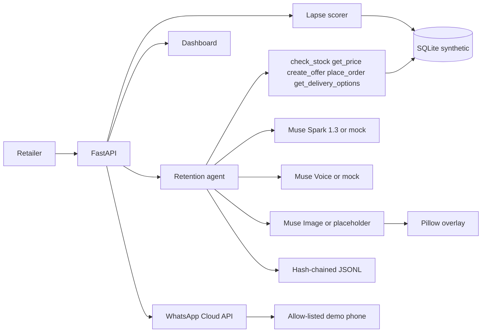

# Convoplex Retention Agent

An AI agent that finds a Nigerian retailer's lapsed customers and wins them back with WhatsApp-style messages.

Built in Lagos for Nigerian retailers, during the Meta AI Developer Hackathon, Oct 27 to Nov 4 2026. Indie track, solo builder. Theme: Build for Your World.

All application code in this repository was written during the event. The dataset is synthetic.

## What it does

A shop in Lagos, Abuja, or Port Harcourt quietly loses regulars. Convoplex scores who has gone quiet, explains why, and drafts a personal message in English or Broken English (Nigerian Pidgin) with a real naira price from the shelf. If the customer accepts, the agent places the order and decrements stock.

This build is the core, end to end, on synthetic data:

- 500 fictional customers across six shops, with orders from 27 Apr 2026 to 26 Oct 2026. Scores use a scenario date of 27 Oct 2026 so the demo does not drift after the event.
- RFM-style lapse scoring with a written reason for every customer.
- A Muse Spark tool loop: `check_stock`, `get_price`, `create_offer`, `place_order`, and `get_delivery_options` (synthetic pickup and a 1–2 day same-city window). The model is told not to invent a delivery weekday.
- The payday state stays in context. The first win-back writes one natural sentence in the customer's language (on 27 Oct, Broken English "Month-end dey this week, e good time to stock up."). The raw state is not pasted into the message. A decline does not mention payday. Festive notes are included when they apply.
- An append-only hash-chained action log, with a verify command.
- A FastAPI backend for the at-risk list, win-back, replies, metrics, and the log.
- Voice-note replies. OGG/Opus is converted to mono 16-bit WAV, transcribed, and fed through the same decline / price question / accept path as a typed reply. The action log stores the transcript, latency, and model.
- Promo cards. `muse-image-1.0` draws a text-free product photo. Pillow then prints the shop, the product, the naira prices, and the percent off, so the numbers match the offer.
- A single-page dashboard for the three-minute demo: customers by shop, the thread, a reply box, a voice-note upload, the promo card, metrics, and the action log with a verify button.
- WhatsApp as a real channel on the Cloud API test number. The simulator stays the default. Live sends go only to one allow-listed phone.

The fictional customer numbers are never dialled. When the channel is WhatsApp, every outbound message is redirected to `WHATSAPP_DEMO_TO` and the action log stores the synthetic customer id with the demo number masked to its last two digits.

## Meta models

| Model | Role in this build |
| --- | --- |
| `muse-spark-1.3` | Drafts the win-back and handles the reply. OpenAI-compatible `POST /v1/chat/completions` on `https://api.meta.ai/v1`. Tools are the shop functions above. `max_tokens` floors at 2500 while tools are attached, because reasoning tokens count against the limit. A `finish_reason` of `length` is retried once at double that budget. |
| `muse-voice-transcribe-1.0` | Transcribes a voice-note reply. `POST /v1/asr/transcribe` is multipart: a JSON `request` part (`model`, `audioEncoding` `WAV`, `mode` `PUSH_TO_TALK`) plus the audio file. Audio must be mono 16-bit WAV at 16 or 24 kHz. OGG/Opus notes are converted with `ffmpeg -i in.ogg -ac 1 -ar 16000 -sample_fmt s16 out.wav`. |
| `muse-image-1.0` | Draws the product photo for a promo card. `POST /v1/images/generations` with `model`, `prompt`, and `n`, response `data[0].b64_json` (WEBP). The prompt names the shop, city, product, and naira prices, and tells the model not to paint text. Pillow overlays the exact figures. |

The API key is the `META_API_KEY` environment variable. It is never written to the database, the action log, or this repo. When the variable is unset, the agent uses a deterministic mock that issues the same tool-call shape. Tests and CI run in mock mode.

## Architecture



Scoring rules, in short: cadence is the median gap between orders, capped at 45 days. Repeat customers still inside 35 days and 1.25× cadence are active. Quiet up to 60 days and within 2× cadence are at risk. Beyond that, up to 120 days, they are lapsed. Longer than 120 days is lost. The priority score weights lapse more heavily than raw spend, and every score comes with the numbers that produced it.

Offers are 5 to 15 percent off the database price. The model cannot name its own price. `place_order` caps quantity at the shelf and at 10 units per order. Accepting an offer places a `whatsapp_sim` order. That label is the synthetic shop sale. It is not a WhatsApp catalog order. A live WhatsApp send, when the channel is on, is a separate Cloud API call to the demo phone.

## Synthetic data

Every retailer, customer, order, product, and offer row is fictional and the schema rejects a row that is not marked synthetic. Prices are illustrative whole naira amounts, not live market quotes. Phone numbers are generated. Do not message them.

Shops: Mama Nkechi Provisions (Ikeja), Alhaja Bisi Textiles (Lagos Island), Computer Village Mobile (Ikeja), Wuse Fresh Basket (Wuse 2), GRA Lace & Ankara (Port Harcourt), Garki Gadget Hub (Garki). The catalogue covers provisions, Ankara and lace, phones, and accessories. Shelf quantities are the current stock, not a reconstruction of the last six months.

## Setup

Python 3.11 or newer.

```bash
python -m venv .venv
source .venv/bin/activate
pip install -r requirements.txt
pip install -e .
cp .env.example .env   # optional; put the real key in the shell, not in git
```

`pip install -e .` installs the `convoplex` package (and its `integrations` and `synthetic` subpackages). `pytest` adds the repo root to `pythonpath`, so a checkout works without the editable install too.

`.env` is gitignored. `.env.example` has placeholders only.

## Commands

```bash
pytest
python -m convoplex generate
python -m convoplex demo
python -m convoplex verify
python -m convoplex serve
python -m convoplex whatsapp check
python -m convoplex whatsapp send-template
python -m convoplex serve --channel whatsapp --tunnel
```

`serve` is the dashboard. Open `http://127.0.0.1:8000/`. The page lists at-risk and lapsed customers by shop, with the written lapse reason. Send a win-back, reply in the box, or upload an OGG or WAV voice note. Generate the promo card for the offer. Metrics and the action log sit on the same page. **Verify chain** reports pass or fail. **Reset demo** asks once to confirm, then rebuilds the synthetic database, deletes the action log, and removes promo cards. Offer ids start again at 1, so old cards are cleared with the database.

`demo` leaves an existing database in place and appends to the action log. `demo --reset` and `generate` write a fresh database and delete the action log, because the old chain would describe a database that no longer exists. With no extra flags the demo picks a lapsed customer who prefers Broken English (Nigerian Pidgin), drafts an offer, accepts it with "Yes o, no wahala. Abeg send am today.", places the order, and verifies the action log.

A declined offer stays valid while the product is in stock. A later question quotes the offer price, and a later accept charges that price even if the model omits `offer_id`. Once that offer is accepted it counts as accepted: `offers_declined` only includes offers that are still declined. Follow-up replies do not greet again. The agent reuses stock and price results already in the thread. On acceptance it calls `get_delivery_options` before `place_order`, and the confirmation offers pickup or delivery.

To show a decline, a question, or an accept for one customer:

```bash
python -m convoplex demo --mock --customer 184 --lang pcm \
  --reply "No thank you, maybe next month" \
  --reply "How much last price?" \
  --reply "Ok I go take 2"
```

`--lang en` or `--lang pcm` overrides the customer's saved language for that run. Repeat `--reply` once per turn. Omit `--reply` to keep the default accepting reply. `--live` uses Muse Spark, Muse Voice, and Muse Image instead of the mocks.

A voice note is transcribed and handled as one more reply. `--promo-card` draws the card for the offer and prints the WEBP path under `output/promo/` (gitignored).

```bash
python -m convoplex demo --mock --customer 184 --voice note.ogg --promo-card
```

In mock mode the transcript is deterministic and comes from the file name, so a demo can show all three intents without a microphone:

| File name contains | Transcript |
| --- | --- |
| `decline`, `no-thanks`, `not-now` | No thank you, maybe next month |
| `price`, `question`, `how-much` | How much last price? |
| anything else, including `note.wav` | Yes o, no wahala. Abeg send am today. |

OGG and Opus need `ffmpeg` on `PATH`. If it is missing, the command exits with the exact conversion it could not run. A mono 16-bit WAV at 16 or 24 kHz is sent through as-is. Promo cards need DejaVu Sans (`fonts-dejavu-core`) so the naira sign draws correctly.

API (after `serve`, default `http://127.0.0.1:8000`):

- `GET /health`
- `GET /v1/customers/at-risk`
- `GET /v1/customers/{id}`
- `POST /v1/customers/{id}/winback`
- `GET /v1/customers/{id}/thread` — the WhatsApp-style transcript, the latest offer, and any order placed from an offer
- `POST /v1/customers/{id}/reply` with `{"text": "..."}`
- `POST /v1/voice/transcribe` — multipart `request` (JSON) and `audio` (OGG or WAV). Optional form field `customer_id` runs that transcript through the reply flow. The action log gets a `model_call` with `task` `transcribe`, `transcript`, `latency_ms`, and `model`.
- `POST /v1/offers/{id}/promo-card` — writes `output/promo/offer-{id}.webp` and returns `path` and `url` (`/media/promo/offer-{id}.webp`). The log stores the model, latency, prompt, and the overlay figures.
- `GET /v1/metrics` — win-back rate (accepted ÷ sent), naira recovered, offers sent, declined, and accepted, plus token totals and latency summed from `model_call` log entries (`prompt_tokens`, `completion_tokens`, `reasoning_tokens`, `total_tokens`, `model_calls`, `model_latency_ms`). Transcription and promo-card calls are included. A declined offer that is later accepted moves to `offers_accepted`. `offers_declined` does not include it.
- `GET /v1/actions` and `POST /v1/actions/verify`
- `POST /v1/demo/reset` — regenerates the 500-customer synthetic database, deletes the action log, and deletes promo cards
- `GET /` — the dashboard
- `GET /v1/whatsapp/status` — channel, missing env names, 24-hour window, last delivery status, masked demo number
- `POST /v1/whatsapp/channel` with `{"channel": "simulator"}` or `{"channel": "whatsapp"}`
- `POST /v1/whatsapp/customer` with `{"customer_id": 184}` — inbound messages from the demo phone map to this customer
- `POST /v1/customers/{id}/whatsapp` — send the win-back to the demo phone, or `hello_world` if the 24-hour window is closed
- `POST /v1/offers/{id}/whatsapp` — upload the promo card and send it, or send `hello_world` if the window is closed
- `GET` and `POST /v1/whatsapp/webhook` — Meta handshake, inbound text and audio, delivery ticks. The access token is never logged.

Interactive docs: `http://127.0.0.1:8000/docs`.

## Real Muse Spark demo

No key is required for tests. To run the same scenario against the API:

```bash
export META_API_KEY=your_dev_meta_ai_key
python -m convoplex demo --live
```

`--mock` forces the offline model even if the key is set. `CONVOPLEX_LLM=auto` (the default) uses live mode only when `META_API_KEY` is set.

The live chat request is `POST https://api.meta.ai/v1/chat/completions` with `Authorization: Bearer $META_API_KEY` and a JSON body of `model`, `messages`, `tools`, and `max_tokens`. The model is `muse-spark-1.3`. Tool results are sent back as `{"role": "tool", "tool_call_id": "...", "content": "..."}`. The tool-call floor is 2500. If Muse Spark still stops with `finish_reason=length`, the client retries that call once with double the budget, then records both attempts in the action log.

Voice and image use the same key and base URL. With the key exported, this runs the win-back, transcribes `path.ogg`, and draws the promo card:

```bash
export META_API_KEY=your_dev_meta_ai_key
python -m convoplex demo --live --customer 184 --voice path.ogg --promo-card
```

Or start the dashboard in live mode and use the buttons:

```bash
export META_API_KEY=your_dev_meta_ai_key
export CONVOPLEX_LLM=live
python -m convoplex serve
```

Direct calls, after `serve`:

```bash
curl -s -F 'request={"model":"muse-voice-transcribe-1.0","audioEncoding":"WAV","mode":"PUSH_TO_TALK"};type=application/json' \
  -F 'audio=@path.ogg;type=audio/ogg' \
  -F 'customer_id=184' \
  http://127.0.0.1:8000/v1/voice/transcribe

curl -s -X POST http://127.0.0.1:8000/v1/offers/1/promo-card
```

The voice upstream is `POST https://api.meta.ai/v1/asr/transcribe`. The image upstream is `POST https://api.meta.ai/v1/images/generations`. Tests never call either. They use a fake transport for the live request shape and the deterministic mock for behaviour.

## Action log

Each line of `data/actions.jsonl` is one message, tool event, or model call. `hash` is SHA-256 over the rest of the entry, including `prev_hash`. The first `prev_hash` is 64 zeroes. `python -m convoplex verify` recomputes the chain and exits non-zero on the first break. The writer only appends. A `model_call` entry stores `latency_ms`, `finish_reason`, the `max_tokens` sent, the attempt number (1, or 2 after a length retry), and token usage.

## WhatsApp Cloud API

The simulator is the default. Nothing is sent unless `CONVOPLEX_CHANNEL=whatsapp` (or `serve --channel whatsapp`, or the dashboard switch **WhatsApp live**) and the recipient is `WHATSAPP_DEMO_TO`. That number is your own phone. Put it in the shell, not in git. Synthetic customers keep their fictional numbers on screen. The demo phone plays the customer.

Outside the 24-hour customer service window, WhatsApp only accepts an approved template. Convoplex sends the test-number template `hello_world` (`en_US`) and says so on the dashboard. After the demo phone messages in, free-form text and the promo card can go out. The card is uploaded as JPEG (`POST /{phone_number_id}/media`) and sent as an image with a caption. Inbound text and voice notes from that phone run through the same reply flow, and the agent's answer is sent back. Voice notes are downloaded with `GET /{media_id}` and then the media URL, both with the bearer token, and transcribed with the existing voice path.

Cloud API message ids (`wamid.HBgN…`) embed the recipient number in base64. Convoplex stores the SHA-256 of that id for dedupe and for matching `sent` / `delivered` / `read` webhooks, and shows only the last six characters. The full id is not written to the action log, the WhatsApp state file, API responses, the dashboard, or the CLI.

Config, all from the environment:

| Variable | Role |
| --- | --- |
| `WHATSAPP_TOKEN` | Cloud API access token. Never logged, never committed. `WHATSAPP_ACCESS_TOKEN` is still read if `WHATSAPP_TOKEN` is unset. |
| `WHATSAPP_PHONE_NUMBER_ID` | The test number's phone number id. |
| `WHATSAPP_VERIFY_TOKEN` | You choose this. Meta sends it back on the webhook handshake. |
| `WHATSAPP_APP_SECRET` | Required for WhatsApp live. `serve` and `serve --tunnel` refuse to start when `CONVOPLEX_CHANNEL=whatsapp` (or `--channel whatsapp`) and this is unset. Live `POST /v1/whatsapp/webhook` rejects a missing or invalid `X-Hub-Signature-256` with 403. The simulator still accepts unsigned posts when this is unset. |
| `WHATSAPP_DEMO_TO` | The only recipient. Country code, plus sign optional. Same digits WhatsApp puts in `from`. |
| `GRAPH_API_VERSION` | Optional, default `v21.0`. |
| `CONVOPLEX_CHANNEL` | `simulator` (default) or `whatsapp`. |

Graph base: `https://graph.facebook.com/{version}/{phone_number_id}/messages`.

Setup, then a live check that prints the display number and quality and does not print the token:

```bash
export WHATSAPP_TOKEN=your_token
export WHATSAPP_PHONE_NUMBER_ID=your_phone_number_id
export WHATSAPP_VERIFY_TOKEN=a_string_you_choose
export WHATSAPP_DEMO_TO=2348012345678
export WHATSAPP_APP_SECRET=your_app_secret   # required before serve --channel whatsapp
export CONVOPLEX_CHANNEL=whatsapp
python -m convoplex whatsapp check
python -m convoplex whatsapp customer 184
python -m convoplex whatsapp send-template
python -m convoplex whatsapp winback --customer 184 --lang pcm
python -m convoplex whatsapp winback --customer 184 --promo-card
```

`whatsapp winback` is the same send as `POST /v1/customers/184/whatsapp`. `--lang` applies when a new draft is written. `--promo-card` draws the card if it is missing and sends it the same way as `POST /v1/offers/{id}/whatsapp`. The printed message id is only the short tail.

`whatsapp customer 184` maps inbound messages to that synthetic customer. The dashboard does the same thing when you select a customer. If nothing is selected and customer 184 exists, inbound messages use 184.

Expose the webhook with a Cloudflare quick tunnel. Subscribe to the `messages` field. The command prints the callback URL and the verify token to paste into the Meta app. It does not print the access token. It exits before opening the tunnel if `WHATSAPP_APP_SECRET` is unset, so the public URL cannot accept unsigned posts.

```bash
python -m convoplex serve --channel whatsapp --tunnel
```

If `cloudflared` is not installed, the process still serves on `127.0.0.1:8000` and prints:

```bash
cloudflared tunnel --url http://127.0.0.1:8000
```

Paste `https://<host>.trycloudflare.com/v1/whatsapp/webhook` as the callback URL. Meta cannot call `127.0.0.1`. cloudflared's output is copied to `output/cloudflared.log` for the whole run, including after the URL is printed.

On a public HTTPS host, skip `--tunnel`. `PORT` selects the listen port and binds `0.0.0.0`. `PUBLIC_BASE_URL` is the origin printed as the callback:

```bash
export PORT=8080
export PUBLIC_BASE_URL=https://your-host.example
python -m convoplex serve --channel whatsapp
```

On the dashboard, **Simulator / WhatsApp live** shows whether env is missing, whether the 24-hour window is open, and the last status (`sent`, `delivered`, `read`). **Send on WhatsApp** on the win-back and on the promo card delivers to the masked demo number. Ticks on a shop bubble come from status webhooks. The demo number is shown as the last two digits only.

Tests never call Graph. They use a fake transport. `pytest` covers request shapes, the allow-list, signature checks, dedupe, the 24-hour window, and inbound text and audio.

## Languages

English (`en`) is the default for a customer who has not chosen. The other options are opt-in: Broken English (`pcm`; Nigerian Pidgin), Igbo (`ig`), Yoruba (`yo`), and Hausa (`ha`). The dashboard and any message the customer sees call `pcm` Broken English. This README says Broken English (Nigerian Pidgin) so the code and the local name are both clear.

The preference is stored on the customer row: `language`, `language_opted_in`, `language_opted_in_at`, and `language_channel` (`seed`, `whatsapp`, or `dashboard`). A migration adds those columns on an existing SQLite file or on Neon and widens the check constraint. Seeded customers who are not English are stored as an explicit opt-in. Customer 184, the live WhatsApp demo customer, stays on Broken English.

On WhatsApp, a customer can reply `language`, `lang`, `change language`, or the language name (English or the local name, with or without diacritics, any case). A name switches immediately and the confirmation is in the new language. `language` sends an interactive list inside the 24-hour window. Outside that window the existing `hello_world` template is still the only outbound message. The first WhatsApp reply to a customer who is still on default English adds one line about how to change language, and that line is not repeated.

Prices stay in ₦. Product names stay as they are in the catalogue. The model is told not to mix languages unless the customer already did.

## Deploy to Vercel

The public app is one Vercel Python function. `app.py` exports `app = create_app()`. `vercel.json` turns on Fluid Compute and sets `maxDuration` to 300 seconds so a Hobby deployment stays inside the platform maximum. That budget covers a cold start that seeds the synthetic book, plus a Muse image or voice call.

Vercel function duration, with Fluid Compute:

| Plan | Default | Maximum |
| --- | --- | --- |
| Hobby | 300 seconds | 300 seconds |
| Pro | 300 seconds | 800 seconds |

Pro also has an extended-duration beta of up to 1800 seconds for Python 3.12, 3.13, and 3.14. This repo pins `functions.app.py.maxDuration` at 300 so Hobby can deploy it. On Pro, raise that value in `vercel.json` (up to 800, or the extended beta limit) if image or voice calls need longer than five minutes.

Local runs and tests stay on SQLite and the JSONL action log. Set `DATABASE_URL` and the same process uses Postgres: the shop, the hash-chained action log, promo-card bytes, the WhatsApp session (24-hour window and message-id hashes), and the rate-limit counters. Install Neon from the Vercel Marketplace and use the `DATABASE_URL` it writes. If the integration also offers a pooled connection string, use that one so serverless instances share Neon's pooler. The first request seeds the 500 synthetic customers when the customers table is empty.

Promo cards are stored in Postgres (`promo_cards.image`), not on the function disk and not in Vercel Blob, so there is no Blob token to set. A local file is still written when the disk is writable. OGG voice notes are converted with `ffmpeg` from `PATH`, or with the static binary from `imageio-ffmpeg` when `PATH` has none. The WhatsApp webhook returns 200 before the reply is generated. FastAPI `BackgroundTasks` keep running after that response on Vercel Python (the `waitUntil` equivalent), so the model call stays inside the same invocation without holding Meta's webhook timeout.

`/healthz` returns 200, or 503 when `DATABASE_URL` is set and the database does not answer. `/health` is the fuller dashboard check. Responses send `X-Content-Type-Options`, `X-Frame-Options`, `Referrer-Policy`, `Permissions-Policy`, and a Content-Security-Policy that allows the dashboard's inline script. Request bodies over 20 MB are rejected with 413. Access logs are one JSON line per request (method, path, status) and omit query strings, so `hub.verify_token` is not logged.

Promo cards draw with DejaVu Sans bundled in `convoplex/fonts` (DejaVuSans.ttf and DejaVuSans-Bold.ttf, plus the Bitstream Vera license). `vercel.json` lists that directory in `includeFiles` because the Vercel function image has no system fonts. The loader uses the package path first and a system DejaVu install only if the bundle is missing. The face covers ₦ and the Latin letters used for Igbo, Yoruba, and Hausa (ọ, ẹ, ṣ, ụ, ị, ń, ɓ, ɗ, ƙ, ƴ).

When `ADMIN_TOKEN` is set, these routes require it via `Authorization: Bearer`, `X-Admin-Token`, or the dashboard **Unlock** form (httponly cookie): reset demo, channel switch, WhatsApp sends, the demo-customer mapping, and a customer's language. The public page stays readable. Win-back, reply, voice, and promo-card are the try-it path: `TRY_IP_LIMIT` requests per IP per `TRY_WINDOW_SECONDS` (default 60 per 3600 seconds). Live Meta chat, image, and transcription calls share `META_DAILY_CAP` (default 80 per UTC day). Past the cap, chat and voice fall back to the mock. A promo card past the cap returns 429 unless the caller is the admin, who bypasses the cap. The webhook is not rate-limited and does not require the admin token. It still requires a valid `X-Hub-Signature-256` when the channel is WhatsApp live. Leave `ADMIN_TOKEN` unset on your laptop: the local API stays open, which is what the tests expect.

In the Vercel project, set the secrets in the dashboard (not in git):

| Variable | Value |
| --- | --- |
| `META_API_KEY` | Muse key. Secret. |
| `WHATSAPP_TOKEN` | Cloud API token. Secret. |
| `WHATSAPP_APP_SECRET` | Meta app secret. Required for the live webhook. Secret. |
| `WHATSAPP_VERIFY_TOKEN` | The string you choose for the handshake. Secret. |
| `WHATSAPP_DEMO_TO` | The only number the agent will message. Secret. |
| `ADMIN_TOKEN` | Unlocks reset, the channel switch, and WhatsApp sends. Secret. |
| `WHATSAPP_PHONE_NUMBER_ID` | `1150414038145295` |
| `CONVOPLEX_CHANNEL` | `whatsapp` for live sends. `simulator` keeps sends on the page. |
| `GRAPH_API_VERSION` | Optional. Default `v21.0`. |
| `DATABASE_URL` | Set by the Neon Marketplace integration. |
| `META_DAILY_CAP` | Optional. Default `80`. |
| `TRY_IP_LIMIT` | Optional. Default `60`. |
| `TRY_WINDOW_SECONDS` | Optional. Default `3600`. |

`PUBLIC_BASE_URL` overrides the host when you want a custom domain in the printed callback. Otherwise the app uses `VERCEL_PROJECT_PRODUCTION_URL`, then `VERCEL_URL`, both set by Vercel.

Webhook callback, subscribed to the `messages` field:

```text
https://<project>.vercel.app/v1/whatsapp/webhook
```

Replace `<project>` with the Vercel project name. Paste `WHATSAPP_VERIFY_TOKEN` into the Meta app as the verify token.

## What was not run live

Voice, image, and WhatsApp live calls were not executed in this environment. `META_API_KEY` and the WhatsApp secrets are not available here. Mock mode and the fake Graph transport cover the offline path. The live commands above are what to run on a machine that has the keys and a test number.

## Contributors

Victor Obioma Umozurike — solo builder, Indie track.
