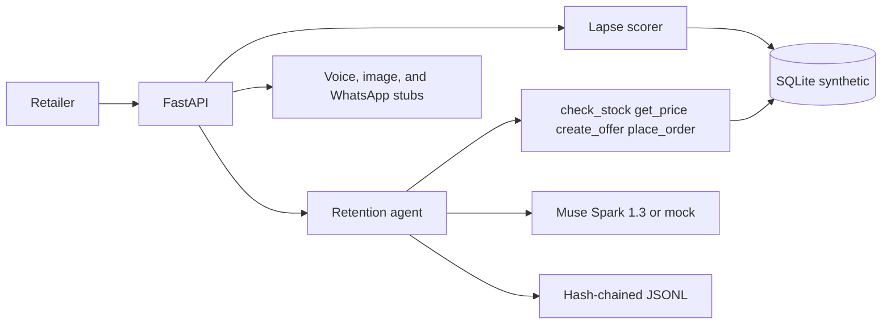

# Convoplex Retention Agent

An AI agent that finds a Nigerian retailer's lapsed customers and wins them back with WhatsApp-style messages.

Built in Lagos for Nigerian retailers, during the Meta AI Developer Hackathon, Oct 27 to Nov 4 2026. Indie track, solo builder. Theme: Build for Your World.

All application code in this repository was written during the event. The dataset is synthetic.

## What it does

A shop in Lagos, Abuja, or Port Harcourt quietly loses regulars. Convoplex scores who has gone quiet, explains why, and drafts a personal message in English or Nigerian Pidgin with a real naira price from the shelf. If the customer accepts, the agent places the order and decrements stock.

This build is the core, end to end, on synthetic data:

- 500 fictional customers across six shops, with orders from 27 Apr 2026 to 26 Oct 2026. Scores use a scenario date of 27 Oct 2026 so the demo does not drift after the event.
- RFM-style lapse scoring with a written reason for every customer.
- A Muse Spark tool loop: `check_stock`, `get_price`, `create_offer`, `place_order`.
- Messages mention month-end payday and festive seasons when those notes apply.
- An append-only hash-chained action log, with a verify command.
- A FastAPI backend for the at-risk list, win-back, replies, metrics, and the log.

Voice notes, promo cards, and the WhatsApp Cloud API are stubbed. Their HTTP contracts and API clients are in the repo so a later day can turn them on without changing the agent loop.

## Meta models

| Model | Role in this build |
| --- | --- |
| `muse-spark-1.3` | Drafts the win-back and handles the reply. OpenAI-compatible `POST /v1/chat/completions` on `https://api.meta.ai/v1`. Tools are the four shop functions. `max_tokens` is at least 1000 because reasoning tokens count against the limit. |
| `muse-voice-transcribe-1.0` | Stub. Client is ready for `POST /v1/asr/transcribe` (multipart JSON `request` part plus mono 16-bit WAV at 16 kHz). OGG voice notes are converted with `ffmpeg -i in.ogg -ac 1 -ar 16000 -sample_fmt s16 out.wav`. |
| `muse-image-1.0` | Stub. Client is ready for `POST /v1/images/generations` and decodes `data[0].b64_json` as WEBP. |

The API key is the `META_API_KEY` environment variable. It is never written to the database, the action log, or this repo. When the variable is unset, the agent uses a deterministic mock that issues the same tool-call shape. Tests and CI run in mock mode.

## Architecture



Scoring rules, in short: cadence is the median gap between orders, capped at 45 days. Repeat customers still inside 35 days and 1.25× cadence are active. Quiet up to 60 days and within 2× cadence are at risk. Beyond that, up to 120 days, they are lapsed. Longer than 120 days is lost. The priority score weights lapse more heavily than raw spend, and every score comes with the numbers that produced it.

Offers are 5 to 15 percent off the database price. The model cannot name its own price. Accepting an offer places a `whatsapp_sim` order. That label means the conversation was simulated. This build does not send a WhatsApp message.

## Synthetic data

Every retailer, customer, order, product, and offer row is fictional and the schema rejects a row that is not marked synthetic. Prices are illustrative whole naira amounts, not live market quotes. Phone numbers are generated. Do not message them.

Shops: Mama Nkechi Provisions (Ikeja), Alhaja Bisi Textiles (Lagos Island), Computer Village Mobile (Ikeja), Wuse Fresh Basket (Wuse 2), GRA Lace & Ankara (Port Harcourt), Garki Gadget Hub (Garki). The catalogue covers provisions, Ankara and lace, phones, and accessories. Shelf quantities are the current stock, not a reconstruction of the last six months.

## Setup

Python 3.11 or newer.

```bash
python -m venv .venv
source .venv/bin/activate
pip install -r requirements.txt
cp .env.example .env   # optional; put the real key in the shell, not in git
```

`.env` is gitignored. `.env.example` has placeholders only.

## Commands

```bash
pytest
python -m convoplex generate
python -m convoplex demo
python -m convoplex verify
python -m convoplex serve
```

`demo` leaves an existing database in place and appends to the action log. `demo --reset` and `generate` write a fresh database; `--reset` also starts a new log, because the old chain would describe a database that no longer exists. The demo picks a lapsed customer who prefers Pidgin, drafts an offer, accepts it with "Yes o, no wahala. Abeg send am today.", places the order, and verifies the action log.

API (after `serve`, default `http://127.0.0.1:8000`):

- `GET /health`
- `GET /v1/customers/at-risk`
- `GET /v1/customers/{id}`
- `POST /v1/customers/{id}/winback`
- `POST /v1/customers/{id}/reply` with `{"text": "..."}`
- `GET /v1/metrics` — win-back rate (accepted ÷ sent), naira recovered, offers sent
- `GET /v1/actions` and `POST /v1/actions/verify`
- `POST /v1/voice/transcribe` — stub, validates multipart audio
- `POST /v1/offers/{id}/promo-card` — stub, returns the image request it would send
- `GET` and `POST /v1/whatsapp/webhook` — handshake and parse only; nothing is sent

Interactive docs: `http://127.0.0.1:8000/docs`.

## Real Muse Spark demo

No key is required for tests. To run the same scenario against the API:

```bash
export META_API_KEY=your_dev_meta_ai_key
python -m convoplex demo --live
```

`--mock` forces the offline model even if the key is set. `CONVOPLEX_LLM=auto` (the default) uses live mode only when `META_API_KEY` is set.

The live request is `POST https://api.meta.ai/v1/chat/completions` with `Authorization: Bearer $META_API_KEY` and a JSON body of `model`, `messages`, `tools`, and `max_tokens`. The model is `muse-spark-1.3`. Tool results are sent back as `{"role": "tool", "tool_call_id": "...", "content": "..."}`. Raise `META_MAX_TOKENS` if a call stops with `finish_reason=length` (the floor while tools are attached is 1000).

## Action log

Each line of `data/actions.jsonl` is one message or tool event. `hash` is SHA-256 over the rest of the entry, including `prev_hash`. The first `prev_hash` is 64 zeroes. `python -m convoplex verify` recomputes the chain and exits non-zero on the first break. The writer only appends.

## What is stubbed

- Voice Transcribe for voice-note replies. The route checks the multipart body and, for OGG, reports the ffmpeg conversion. It returns HTTP 501.
- Muse Image promo cards. The route returns HTTP 501 with the `/images/generations` body (`model`, `prompt`, `n`).
- WhatsApp Cloud API. GET verifies `hub.challenge` when `WHATSAPP_VERIFY_TOKEN` is set. POST parses text and audio messages and does not reply. `build_send_text_request` documents the Graph API call for a later day. Test sends, when they exist, must go only to the builder's own numbers. Those numbers are not in this repo.

A dashboard is also a later day. Metrics are available from `GET /v1/metrics` now.

## Contributors

Victor Obioma Umozurike — solo builder, Indie track.
